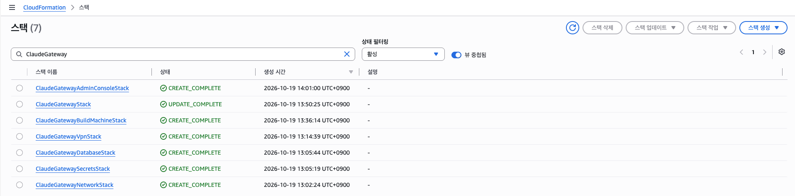
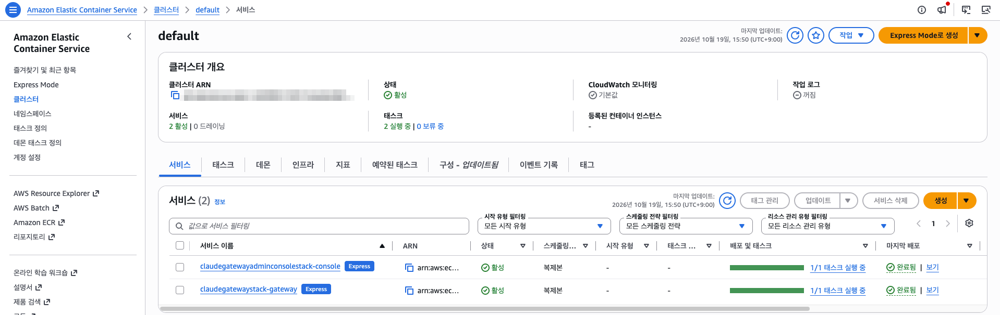
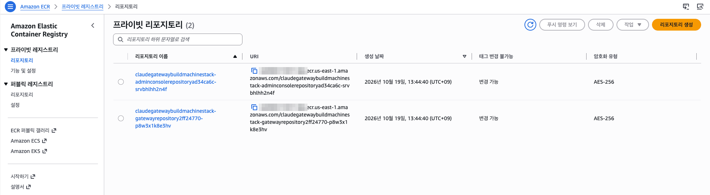
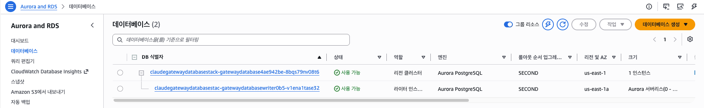
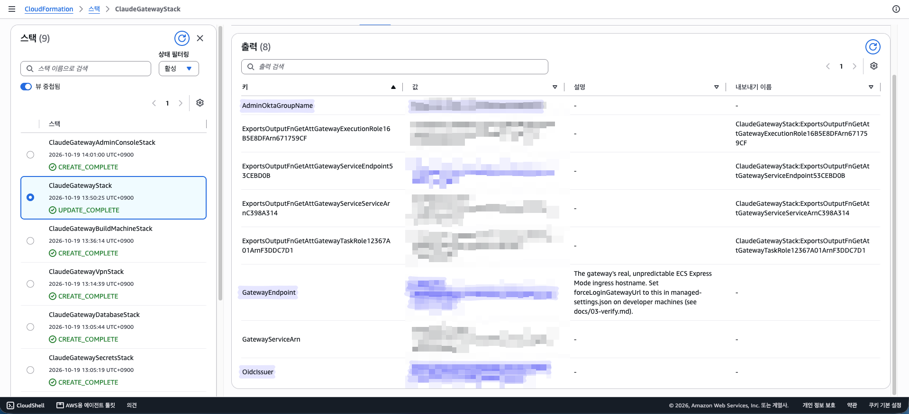
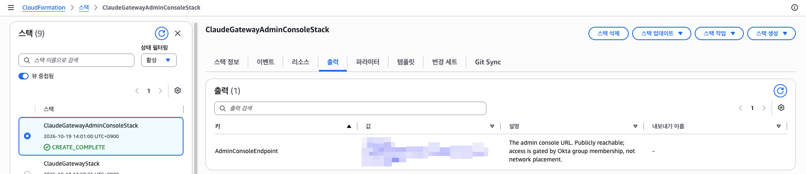

# 4. CDK 배포

[1단계](01-entra-id.md)에서 만든 값으로 bootstrap 하고 스택 7개를 배포합니다. 여기부터는 `cdk/` 에서 실행합니다.


```bash
cd cdk
```

모든 CDK 명령에 컨텍스트 네 개를 넘깁니다.

| 컨텍스트 키 | 셸 변수 | 비고 |
| --- | --- | --- |
| `oidcIssuer` | `$ISSUER` | 필수 |
| `oidcClientId` | `$APP` | 필수 |
| `oidcClientSecret` | `$SECRET` | 필수 |
| `adminOktaGroupName` | `$GRP` | 이름은 Okta 지만 그룹 GUID 를 넣음. 빠지면 `claude-gateway-admins` |

## 4.1 bootstrap

CDK 가 배포에 쓰는 S3 버킷·ECR·IAM 롤(`CDKToolkit` 스택)을 계정·Region 당 한 번 만듭니다. bootstrap 에도 컨텍스트가 필요합니다(없으면 `Missing required context values`).

### bootstrap 명령어
```bash
npx cdk bootstrap "aws://$(aws sts get-caller-identity --query Account --output text)/us-east-1" -c oidcIssuer="$ISSUER" -c oidcClientId="$APP" -c oidcClientSecret="$SECRET" -c adminOktaGroupName="$GRP"
```

### bootstrap 결과 예시
```text
 ⏳  Bootstrapping environment aws://123456789012/us-east-1...
...
✅  Environment aws://123456789012/us-east-1 bootstrapped (no changes).
****************************************************
*** Newer version of CDK is available [2.1145.0] ***
...
```

`✅ … bootstrapped` 가 나오면 됩니다. 이미 bootstrap 한 계정이면 `(no changes)` 가 붙습니다. `Newer version of CDK is available` 는 안내 문구라 업그레이드하지 않습니다(이 리포는 `cdk/package.json` 의 CDK 를 `npx` 로 씀).

> [!WARNING]
> `CDKToolkit` 이 `ROLLBACK_COMPLETE` 로 남으면 `iam:CreateRole` 권한 문제입니다. [2.3](02-aws-preparation.md#23-aws-region과-배포-자격증명-고정)의 자격증명 권한을 확인하고 [10장](10-troubleshooting.md)대로 정리합니다.

## 4.2 컨텍스트 파일로 저장

배포 전에 네 값을 `cdk.context.json` 에 저장합니다. 배포 중 셸을 잃어도 [4.5](#45-새-셸에서-변수-복원)로 되살릴 수 있고, 이후 `deploy`·`destroy` 에서 `-c` 를 생략할 수 있습니다.

### 컨텍스트 파일 저장 명령어
뒤의 `jq` 와 `ls` 는 확인용입니다. secret 은 값 대신 길이만 보여 줍니다.

```bash
jq -n --arg i "$ISSUER" --arg a "$APP" --arg s "$SECRET" --arg g "$GRP" '{oidcIssuer:$i, oidcClientId:$a, oidcClientSecret:$s, adminOktaGroupName:$g}' > cdk.context.json && chmod 600 cdk.context.json && jq '.oidcClientSecret |= (length|tostring) + " chars"' cdk.context.json && ls -l cdk.context.json
```

### 컨텍스트 파일 저장 결과 예시
```text
{
  "oidcIssuer": "https://login.microsoftonline.com/xxxxxxxx-xxxx-xxxx-xxxx-xxxxxxxxxxxx/v2.0",
  "oidcClientId": "yyyyyyyy-yyyy-yyyy-yyyy-yyyyyyyyyyyy",
  "oidcClientSecret": "40 chars",
  "adminOktaGroupName": "zzzzzzzz-zzzz-zzzz-zzzz-zzzzzzzzzzzz"
}
-rw-------@ 1 user  staff  286 Oct 19 11:29 cdk.context.json
```

네 값이 1.7 과 같고, 권한이 `-rw-------` 이면 됩니다.

> [!WARNING]
> secret 이 평문으로 들어갑니다. `.gitignore` 대상이지만 파일을 공유하지 않습니다. Windows 에서는 `chmod 600` 이 효과가 없습니다.

## 4.3 배포

스택 7개를 의존 순서대로 만듭니다. 25~35분 걸리고, 대부분 Aurora 생성·이미지 빌드·로드밸런서 생성 시간입니다.

> [!TIP]
> MFA 세션은 1시간입니다. [2.3](02-aws-preparation.md#23-aws-region과-배포-자격증명-고정)의 인증을 **이 명령 바로 앞에서** 다시 실행합니다.

### 배포 명령어
```bash
npx cdk deploy --all -c oidcIssuer="$ISSUER" -c oidcClientId="$APP" -c oidcClientSecret="$SECRET" -c adminOktaGroupName="$GRP"
```

### 배포 승인 화면 예시
보안 그룹이나 IAM 이 바뀌는 스택마다 변경 표를 보여 주고 승인을 묻습니다. 스택 7개 중 대부분에서 나옵니다.

```text
Stack ClaudeGatewayNetworkStack
Security Group Changes
┌───┬─────────────────────────────────┬─────┬────────────┬─────────────────────────────────┐
│   │ Group                           │ Dir │ Protocol   │ Peer                            │
├───┼─────────────────────────────────┼─────┼────────────┼─────────────────────────────────┤
│ + │ ${DatabaseSecurityGroup.GroupId │ In  │ TCP 5432   │ ${GatewayTaskSecurityGroup.Grou │
...
└───┴─────────────────────────────────┴─────┴────────────┴─────────────────────────────────┘

"--require-approval" is enabled and stack includes security-sensitive updates: Do you wish to deploy these changes? (y/n)
```

`y` 를 입력하고 **Enter** 까지 누릅니다. 답하지 않으면 스택이 `REVIEW_IN_PROGRESS` 로 멈추고 다음 스택도 시작하지 않습니다. 자리를 비울 거라면 명령 끝에 `--require-approval never` 를 붙입니다.

### 배포 완료 화면 예시
```text
✅  ClaudeGatewayAdminConsoleStack

✨  Deployment time: ...s

Outputs:
ClaudeGatewayAdminConsoleStack.AdminConsoleEndpoint = https://cl-yyyyyyyyyyyyyyyyyyyyyyyyyyyyyyyy.ecs.us-east-1.on.aws
...
✨  Total time: ...s
```

마지막 `ClaudeGatewayAdminConsoleStack` 의 `✅` 와 `Total time` 이 나오고 프롬프트로 돌아오면 끝입니다.

### 콘솔에서 확인하는 방법
**CloudFormation → 스택**에서 `ClaudeGateway` 로 검색하면 7개 스택이 모두 `CREATE_COMPLETE` 입니다. 다시 실행해 한 번 더 배포된 스택은 `UPDATE_COMPLETE` 로 나옵니다.



**Amazon ECS → 클러스터 → default → 서비스**에 게이트웨이(`claudegatewaystack-gateway`)와 관리 콘솔(`claudegatewayadminconsolestack-console`) 서비스가 `활성`, `1/1 태스크 실행 중`으로 보입니다.



<details>
<summary>빌드된 이미지와 데이터베이스 확인</summary>

**Amazon ECR → 프라이빗 리포지토리**에 BuildMachine 이 이미지를 푸시한 리포지토리 2개(게이트웨이, 관리 콘솔)가 있습니다.



**Aurora and RDS → 데이터베이스**에 Aurora PostgreSQL 클러스터와 라이터 인스턴스가 `사용 가능`으로 보입니다. 클러스터를 열면 [2.5](02-aws-preparation.md#25-aurora-버전-확인)에서 고른 엔진 버전을 확인할 수 있습니다.


</details>

<details>
<summary>배포 중 화면과 스택 상태 확인</summary>

**진행 중**: 승인하면 스택 번호, 리소스 진행 막대, 리소스별 상태가 이어서 나옵니다.

```text
ClaudeGatewayNetworkStack: deploying... [1/7]
[██████████████████████████████████████████████▍···········] (24/30)

1:03:33 PM | CREATE_IN_PROGRESS      | AWS::EC2::VPCEndpoint                 | Vpc/BedrockRu
ntimeEndpoint
1:03:36 PM | CREATE_IN_PROGRESS      | AWS::EC2::NatGateway                  | Vpc/publicSub
net1/NATGateway
```

**스택 하나가 끝날 때**: 출력값이 나오고 바로 다음 스택의 승인을 묻습니다. Vpn 스택의 `ClientVpnEndpointId`·`VpnClientProfileSecretArn` 은 [5단계](05-vpn-and-redirect.md)에서 씁니다.

```text
✅  ClaudeGatewayVpnStack

Outputs:
ClaudeGatewayVpnStack.ClientVpnEndpointId = cvpn-endpoint-xxxxxxxxxxxxxxxxx
ClaudeGatewayVpnStack.VpnClientProfileSecretArn = arn:aws:secretsmanager:us-east-1:123456789012:secret:VpnClientProfileSecret...
...
ClaudeGatewayBuildMachineStack: creating CloudFormation changeset...
```

**IAM 변경 승인 표**: 보안 그룹 대신 IAM Statement Changes / IAM Policy Changes 표가 나오는 스택도 있습니다. 같은 방식으로 `y` + Enter 입니다.

**경고 문구**: 합성 중 `WARNING No cross-stack-reference strength configured` 가 나오지만 CDK 기능 플래그 안내라 배포에 영향이 없습니다.

**스택 상태 확인**: 다른 터미널이나 CloudShell 에서 볼 수 있습니다. 끝나면 7개가 모두 `CREATE_COMPLETE` 입니다(다시 실행한 스택은 `UPDATE_COMPLETE`).

```bash
aws cloudformation list-stacks --region us-east-1 --query "StackSummaries[?starts_with(StackName,'ClaudeGateway') && StackStatus!='DELETE_COMPLETE'].[StackName,StackStatus]" --output text
```

```text
ClaudeGatewayAdminConsoleStack	CREATE_COMPLETE
ClaudeGatewayStack	UPDATE_COMPLETE
ClaudeGatewayBuildMachineStack	CREATE_COMPLETE
ClaudeGatewayVpnStack	CREATE_COMPLETE
ClaudeGatewayDatabaseStack	CREATE_COMPLETE
ClaudeGatewaySecretsStack	CREATE_COMPLETE
ClaudeGatewayNetworkStack	CREATE_COMPLETE
```
</details>

<details>
<summary>세션이 만료돼 중간에 멈췄을 때</summary>

진행 중인 스택은 CloudFormation 이 끝까지 진행하지만, CDK 가 다음 스택을 시작하려면 다시 인증해야 합니다. `Ctrl+C` 로 빠져나와 [2.3](02-aws-preparation.md#23-aws-region과-배포-자격증명-고정) 인증을 다시 하고 **같은 배포 명령**을 실행합니다. 끝난 스택은 `(no changes)` 로 넘어가고 남은 스택부터 승인을 묻습니다.

```text
✅  ClaudeGatewayVpnStack (no changes)

✨  Deployment time: 0s
...
ClaudeGatewayStack: deploying... [6/7]

✅  ClaudeGatewayStack

Outputs:
...
ClaudeGatewayStack.GatewayEndpoint = https://cl-xxxxxxxxxxxxxxxxxxxxxxxxxxxxxxxx.ecs.us-east-1.on.aws
...
Stack ClaudeGatewayAdminConsoleStack
...
"--require-approval" is enabled and stack includes security-sensitive updates: Do you wish to deploy these changes? (y/n)
```
</details>

<details>
<summary>client secret 이 평문으로 남는 이유</summary>

`oidcClientSecret` 은 `cdk.context.json` 과 `cdk.out/` 템플릿에 평문으로 남고, CloudFormation 콘솔에서도 보입니다. 운영에서는 Secrets Manager 에 따로 만들고 ARN 으로 참조합니다.

게이트웨이는 부팅 때 설정 전체를 검증하고 `client_secret` 을 필수로 봅니다. 원본의 이전 설계는 빈 값으로 배포한 뒤 나중에 채웠는데, 게이트웨이가 크래시루프에 빠지고 ECS Express Mode 가 포기하면 CloudFormation 이 스택을 롤백해 고칠 기회가 없었습니다. secret 이 평문으로 남는 것은 원본 코드가 `SecretValue.unsafePlainText` 로 넘기기 때문입니다.
</details>

## 4.4 출력값 기록

이후 단계에서 쓰는 주소 두 개를 조회합니다. 게이트웨이 주소는 [5.2](05-vpn-and-redirect.md#52-entra-리다이렉트-uri-교체) 리다이렉트 URI 에, 관리 콘솔 주소는 [6단계](06-verify.md) 사인인에 씁니다.

### 출력값 조회 명령어
```bash
GWEP=$(aws cloudformation describe-stacks --stack-name ClaudeGatewayStack --query "Stacks[0].Outputs[?OutputKey=='GatewayEndpoint'].OutputValue" --output text) && echo "GWEP=$GWEP"
aws cloudformation describe-stacks --stack-name ClaudeGatewayAdminConsoleStack --query "Stacks[0].Outputs[?OutputKey=='AdminConsoleEndpoint'].OutputValue" --output text
```

### 출력값 조회 결과 예시
```text
GWEP=https://cl-xxxx.ecs.us-east-1.on.aws
https://cl-yyyy.ecs.us-east-1.on.aws
```

첫 줄이 게이트웨이, 둘째 줄이 관리 콘솔 주소입니다. `cl-` 뒤는 32자리 16진수이고, `GWEP` 는 5.2 에서 그대로 씁니다.

### 콘솔에서 확인하는 방법
**CloudFormation → 스택 → ClaudeGatewayStack → 출력** 탭의 `GatewayEndpoint` 가 게이트웨이 주소입니다. 같은 탭에 `OidcIssuer`(1.6), `AdminOktaGroupName`(1.5 의 GUID)도 있습니다.



**ClaudeGatewayAdminConsoleStack → 출력** 탭의 `AdminConsoleEndpoint` 가 관리 콘솔 주소입니다.



<details>
<summary>주소를 서비스에 따로 넣지 않아도 되는 이유</summary>

호스트명은 ECS Express Mode 가 만들어 배포 전에는 알 수 없습니다. 두 스택의 URL fixer Custom Resource 가 각 서비스의 `*_PUBLIC_URL` 환경변수를 실제 값으로 자동으로 고쳐 넣습니다.
</details>

## 4.5 새 셸에서 변수 복원

[4.2](#42-컨텍스트-파일로-저장)의 파일에서 네 변수를 다시 읽습니다. `cdk/` 에서 실행합니다.

### 변수 복원 명령어
```bash
eval "$(jq -r '"export ISSUER=\(.oidcIssuer|@sh) APP=\(.oidcClientId|@sh) SECRET=\(.oidcClientSecret|@sh) GRP=\(.adminOktaGroupName|@sh)"' cdk.context.json)" && echo "APP=$APP GRP=$GRP ISSUER=$ISSUER SECRET_LEN=${#SECRET}"
```

### 변수 복원 결과 예시
```text
APP=yyyyyyyy-yyyy-yyyy-yyyy-yyyyyyyyyyyy GRP=zzzzzzzz-zzzz-zzzz-zzzz-zzzzzzzzzzzz ISSUER=https://login.microsoftonline.com/xxxxxxxx-xxxx-xxxx-xxxx-xxxxxxxxxxxx/v2.0 SECRET_LEN=40
```

Region·자격증명 환경변수([2.3](02-aws-preparation.md#23-aws-region과-배포-자격증명-고정))도 다시 설정합니다. 파일이 없으면 [1.7](01-entra-id.md#변수가-비어-있을-때-셸을-닫거나-새로운-세션으로-진행했을-경우)대로 되살립니다.

다음: [5. VPN 연결과 리다이렉트 URI](05-vpn-and-redirect.md)
