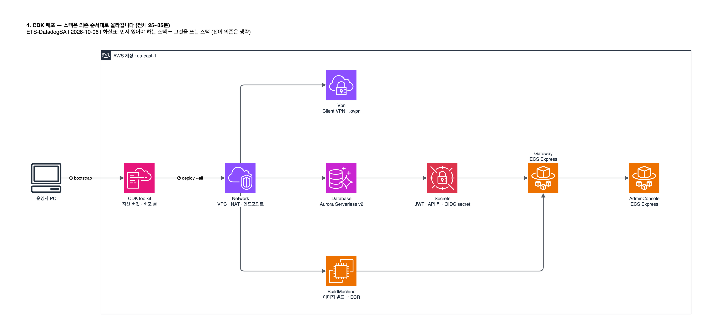

# 4. CDK 배포

[1단계](01-entra-id.md)에서 만든 값으로 bootstrap 하고 스택 7개를 배포합니다. 여기부터는 `cdk/` 에서 실행합니다.



```bash
cd cdk
```

모든 CDK 명령에 컨텍스트 네 개를 넘깁니다.

| 컨텍스트 키 | 셸 변수 | 비고 |
| --- | --- | --- |
| `oidcIssuer` | `$ISSUER` | 필수 |
| `oidcClientId` | `$APP` | 필수 |
| `oidcClientSecret` | `$SECRET` | 필수 |
| `adminOktaGroupName` | `$GRP` | 이름은 Okta 지만 그룹 GUID 를 넣음. 빠지면 `claude-gateway-admins` |

## 4.1 bootstrap

CDK 가 배포에 쓰는 S3 버킷·ECR·IAM 롤(`CDKToolkit` 스택)을 계정·리전당 한 번 만듭니다. bootstrap 에도 컨텍스트가 필요합니다(없으면 `Missing required context values`).

### bootstrap 명령어
```bash
npx cdk bootstrap "aws://$(aws sts get-caller-identity --query Account --output text)/us-east-1" -c oidcIssuer="$ISSUER" -c oidcClientId="$APP" -c oidcClientSecret="$SECRET" -c adminOktaGroupName="$GRP"
```

### bootstrap 결과 예시
이미 bootstrap 한 계정·리전이면 `(no changes)` 로 끝납니다. 처음이면 `CDKToolkit` 스택을 만드는 진행 줄이 이어진 뒤 `bootstrapped` 로 끝납니다.

```text
 ⏳  Bootstrapping environment aws://123456789012/us-east-1...
Trusted accounts for deployment: (none)
Trusted accounts for lookup: (none)
Using default execution policy of 'arn:aws:iam::aws:policy/AdministratorAccess'. Pass '--cloudformation-execution-policies' to customize.
✅  Environment aws://123456789012/us-east-1 bootstrapped (no changes).
****************************************************
*** Newer version of CDK is available [2.1145.0] ***
*** Upgrade recommended (npm install -g aws-cdk) ***
****************************************************
```

`Newer version of CDK is available` 는 안내 문구입니다. 이 리포는 `cdk/package.json` 에 고정된 CDK 를 `npx` 로 쓰므로 업그레이드하지 않습니다.

`CDKToolkit` 이 `ROLLBACK_COMPLETE` 로 남으면 `iam:CreateRole` 권한 문제입니다. → [10장](10-troubleshooting.md)

## 4.2 배포

스택 7개를 의존 순서대로 만듭니다.

> [!TIP]
> 배포는 25~35분 걸리고 MFA 세션은 1시간입니다. [2.3](02-aws-preparation.md#23-aws-region과-배포-자격증명-고정)의 인증을 **이 명령 바로 앞에서** 다시 실행합니다. 그 전에 [4.3](#43-컨텍스트-파일로-저장-선택)으로 변수를 파일에 저장해 두면, 배포 중 셸을 잃어도 [4.5](#45-새-셸에서-변수-복원)로 되살릴 수 있습니다.

### 배포 명령어
```bash
npx cdk deploy --all -c oidcIssuer="$ISSUER" -c oidcClientId="$APP" -c oidcClientSecret="$SECRET" -c adminOktaGroupName="$GRP"
```

### 배포 시작 화면 예시
먼저 Lambda 4개를 esbuild 로 번들링하고 템플릿을 합성한 뒤, 보안 관련 변경이 있는 스택마다 승인을 묻습니다.

```text
Bundling asset ClaudeGatewayVpnStack/ProfileAssemblerFunction/Code/Stage...
...
⚡ Done in 1ms
WARNING No cross-stack-reference strength configured, defaulting to "strong". ...
   ClaudeGatewayDatabaseStack
...
✨  Synthesis time: 4.49s

ClaudeGatewayNetworkStack
...
Stack ClaudeGatewayNetworkStack
Security Group Changes
┌───┬─────────────────────────────────┬─────┬────────────┬─────────────────────────────────┐
│   │ Group                           │ Dir │ Protocol   │ Peer                            │
├───┼─────────────────────────────────┼─────┼────────────┼─────────────────────────────────┤
│ + │ ${AdminConsoleSecurityGroup.Gro │ Out │ Everything │ Everyone (IPv4)                 │
...
│ + │ ${DatabaseSecurityGroup.GroupId │ In  │ TCP 5432   │ ${GatewayTaskSecurityGroup.Grou │
...
│ + │ ${VpcEndpointSecurityGroup.Grou │ In  │ TCP 443    │ ${Vpc.CidrBlock}                │
...
└───┴─────────────────────────────────┴─────┴────────────┴─────────────────────────────────┘

"--require-approval" is enabled and stack includes security-sensitive updates: Do you wish to deploy these changes? (y/n)
```

- `Do you wish to deploy these changes? (y/n)` 에 `y` 를 입력합니다. 승인 전에는 스택이 `REVIEW_IN_PROGRESS` 로 멈춰 있고 리소스가 만들어지지 않습니다.
- `WARNING No cross-stack-reference strength configured` 는 CDK 기능 플래그 안내이며 배포에 영향이 없습니다.
### 배포 진행 화면 예시
`y` 를 입력하면 스택 번호(`[1/7]`), 리소스 진행 막대, 리소스별 상태가 이어서 나옵니다.

```text
"--require-approval" is enabled and stack includes security-sensitive updates: Do you wish to deploy these changes? (y/n) y
ClaudeGatewayNetworkStack: deploying... [1/7]
[██████████████████████████████████████████████▍···········] (24/30)

1:03:03 PM | CREATE_IN_PROGRESS      | AWS::CloudFormation::Stack            | ClaudeGateway
NetworkStack
1:03:33 PM | CREATE_IN_PROGRESS      | AWS::EC2::VPCEndpoint                 | Vpc/SecretsMa
nagerEndpoint
1:03:33 PM | CREATE_IN_PROGRESS      | AWS::EC2::VPCEndpoint                 | Vpc/BedrockRu
ntimeEndpoint
1:03:36 PM | CREATE_IN_PROGRESS      | AWS::EC2::NatGateway                  | Vpc/publicSub
net1/NATGateway
```

이후 스택에서도 IAM 이나 보안 그룹이 바뀌면 같은 질문이 나옵니다. 아래는 3번째 `ClaudeGatewayDatabaseStack` 의 IAM 정책 변경 표입니다(일부 생략). 이번에도 `y` 를 입력합니다.

```text
┌───┬─────────────────────┬────────┬─────────────────────┬─────────────────────┬───────────┐
│   │ Resource            │ Effect │ Action              │ Principal           │ Condition │
├───┼─────────────────────┼────────┼─────────────────────┼─────────────────────┼───────────┤
│ + │ ${GatewayDatabase/S │ Allow  │ secretsmanager:Desc │ AWS:${PostgresUrlCo │           │
│   │ ecret/Attachment}   │        │ ribeSecret          │ mbinerFunction/Serv │           │
...
└───┴─────────────────────┴────────┴─────────────────────┴─────────────────────┴───────────┘
IAM Policy Changes
┌───┬──────────────────────────────────────────┬───────────────────────────────────────────┐
│   │ Resource                                 │ Managed Policy ARN                        │
├───┼──────────────────────────────────────────┼───────────────────────────────────────────┤
│ + │ ${PostgresUrlCombinerFunction/ServiceRol │ arn:${AWS::Partition}:iam::aws:policy/ser │
│   │ e}                                       │ vice-role/AWSLambdaBasicExecutionRole     │
...
└───┴──────────────────────────────────────────┴───────────────────────────────────────────┘

"--require-approval" is enabled and stack includes security-sensitive updates: Do you wish to deploy these changes? (y/n) y
ClaudeGatewayDatabaseStack: deploying... [3/7]
```

### 스택 완료 화면 예시
스택 하나가 끝날 때마다 소요 시간과 출력값이 나오고, 바로 다음 스택의 변경 세트를 만들어 승인을 묻습니다. 출력값의 ID·ARN 은 가렸습니다.

```text
✅  ClaudeGatewayNetworkStack

✨  Deployment time: ...s

Outputs:
ClaudeGatewayNetworkStack.ExportsOutputFnGetAttAdminConsoleSecurityGroup...GroupId... = sg-xxxxxxxxxxxxxxxxx
...
✅  ClaudeGatewaySecretsStack

✨  Deployment time: ...s
...
✅  ClaudeGatewayDatabaseStack

✨  Deployment time: ...s

Outputs:
ClaudeGatewayDatabaseStack.ExportsOutputRefPostgresUrlSecret... = arn:aws:secretsmanager:us-east-1:123456789012:secret:PostgresUrlSecret...
Stack ARN:
arn:aws:cloudformation:us-east-1:123456789012:stack/ClaudeGatewayDatabaseStack/...
ClaudeGatewayVpnStack
ClaudeGatewayVpnStack: creating CloudFormation changeset...
...
✅  ClaudeGatewayVpnStack

✨  Deployment time: ...s

Outputs:
ClaudeGatewayVpnStack.ClientVpnEndpointId = cvpn-endpoint-xxxxxxxxxxxxxxxxx
ClaudeGatewayVpnStack.VpnClientProfileSecretArn = arn:aws:secretsmanager:us-east-1:123456789012:secret:VpnClientProfileSecret...
...
ClaudeGatewayBuildMachineStack
ClaudeGatewayBuildMachineStack: creating CloudFormation changeset...
...
"--require-approval" is enabled and stack includes security-sensitive updates: Do you wish to deploy these changes? (y/n)
```

Vpn 스택 출력의 `ClientVpnEndpointId`·`VpnClientProfileSecretArn` 은 [5단계](05-vpn-and-redirect.md)에서 VPN 프로필을 꺼낼 때 쓰는 값입니다. 스택 순서는 의존 관계에 따라 정해지므로 위 그림의 번호와 다를 수 있습니다.

> [!TIP]
> 승인 질문에 답하지 않으면 다음 스택이 시작되지 않고 기다립니다. 자리를 비울 거라면 처음부터 `--require-approval never` 를 붙입니다.

다른 터미널이나 CloudShell 에서 스택별 상태를 볼 수도 있습니다.

```bash
aws cloudformation list-stacks --region us-east-1 --query "StackSummaries[?starts_with(StackName,'ClaudeGateway') && StackStatus!='DELETE_COMPLETE'].[StackName,StackStatus]" --output text
```

- 25~35분 걸립니다. 대부분 Aurora 생성, 이미지 빌드, 로드밸런서 생성 시간입니다.
- 보안 관련 변경이 있는 스택마다 승인을 묻습니다. `--require-approval never` 로 생략할 수 있습니다.
- 중간에 자격증명이 만료돼도 CloudFormation 은 계속 진행됩니다. 다시 인증하고 같은 명령을 실행합니다.

### 다시 실행한 화면 예시
세션이 만료돼 중간에 멈췄다면 `Ctrl+C` 로 빠져나와 [2.3](02-aws-preparation.md#23-aws-region과-배포-자격증명-고정) 인증을 다시 하고, 같은 배포 명령을 실행합니다. 이미 끝난 스택은 `(no changes)` 로 넘어가고 남은 스택부터 이어서 승인을 묻습니다.

```text
ClaudeGatewayVpnStack: deploying... [5/7]

✅  ClaudeGatewayVpnStack (no changes)

✨  Deployment time: 0s

Outputs:
ClaudeGatewayVpnStack.ClientVpnEndpointId = cvpn-endpoint-xxxxxxxxxxxxxxxxx
...
ClaudeGatewayStack: deploying... [6/7]

✅  ClaudeGatewayStack

Outputs:
ClaudeGatewayStack.AdminOktaGroupName = zzzzzzzz-zzzz-zzzz-zzzz-zzzzzzzzzzzz
...
ClaudeGatewayStack.GatewayEndpoint = https://cl-xxxxxxxxxxxxxxxxxxxxxxxxxxxxxxxx.ecs.us-east-1.on.aws
ClaudeGatewayStack.GatewayServiceArn = arn:aws:ecs:us-east-1:123456789012:service/default/claudegatewaystack-gateway
ClaudeGatewayStack.OidcIssuer = https://login.microsoftonline.com/xxxxxxxx-xxxx-xxxx-xxxx-xxxxxxxxxxxx/v2.0
...
ClaudeGatewayAdminConsoleStack
ClaudeGatewayAdminConsoleStack: creating CloudFormation changeset...
...
Stack ClaudeGatewayAdminConsoleStack
IAM Statement Changes
...
"--require-approval" is enabled and stack includes security-sensitive updates: Do you wish to deploy these changes? (y/n)
```

`y` 를 입력한 뒤 **Enter** 까지 눌러야 진행됩니다. `y` 만 입력된 채로 두면 스택이 `REVIEW_IN_PROGRESS` 에서 움직이지 않습니다.

> [!WARNING]
> `oidcClientSecret` 은 `cdk.context.json` 과 `cdk.out/` 템플릿에 평문으로 남고, CloudFormation 콘솔에서도 보입니다. 운영에서는 Secrets Manager 에 따로 만들고 ARN 으로 참조합니다.

<details>
<summary>client secret 을 빈 값으로 둘 수 없는 이유</summary>

게이트웨이는 부팅 때 설정 전체를 검증하고 `client_secret` 을 필수로 봅니다. 원본의 이전 설계는 빈 값으로 배포한 뒤 나중에 채웠는데, 게이트웨이가 크래시루프에 빠지고 ECS Express Mode 가 포기하면 CloudFormation 이 스택을 롤백해 고칠 기회가 없었습니다. secret 이 평문으로 남는 것은 원본 코드가 `SecretValue.unsafePlainText` 로 넘기기 때문입니다.
</details>

## 4.3 컨텍스트 파일로 저장 (선택)

`cdk.context.json` 에 저장하면 이후 `bootstrap`·`deploy`·`destroy` 에서 `-c` 를 생략할 수 있습니다.

### 컨텍스트 파일 저장 명령어
뒤의 `jq` 와 `ls` 는 확인용입니다. secret 은 값 대신 길이만 보여 줍니다.

```bash
jq -n --arg i "$ISSUER" --arg a "$APP" --arg s "$SECRET" --arg g "$GRP" '{oidcIssuer:$i, oidcClientId:$a, oidcClientSecret:$s, adminOktaGroupName:$g}' > cdk.context.json && chmod 600 cdk.context.json && jq '.oidcClientSecret |= (length|tostring) + " chars"' cdk.context.json && ls -l cdk.context.json
```

### 컨텍스트 파일 저장 결과 예시
```text
{
  "oidcIssuer": "https://login.microsoftonline.com/xxxxxxxx-xxxx-xxxx-xxxx-xxxxxxxxxxxx/v2.0",
  "oidcClientId": "yyyyyyyy-yyyy-yyyy-yyyy-yyyyyyyyyyyy",
  "oidcClientSecret": "40 chars",
  "adminOktaGroupName": "zzzzzzzz-zzzz-zzzz-zzzz-zzzzzzzzzzzz"
}
-rw-------@ 1 user  staff  286 Oct 19 11:29 cdk.context.json
```

네 값이 1.7 과 같고, 권한이 `-rw-------` 이면 됩니다.

secret 이 평문으로 들어가므로 파일 관리에 주의합니다(`.gitignore` 대상). Windows 에서는 `chmod 600` 이 효과가 없습니다.

## 4.4 출력값 기록

배포가 끝나면 두 주소가 출력됩니다.

```
ClaudeGatewayStack.GatewayEndpoint                  = https://cl-xxxx.ecs.us-east-1.on.aws
ClaudeGatewayAdminConsoleStack.AdminConsoleEndpoint = https://cl-yyyy.ecs.us-east-1.on.aws
```

다시 조회할 때:

```bash
GWEP=$(aws cloudformation describe-stacks --stack-name ClaudeGatewayStack --query "Stacks[0].Outputs[?OutputKey=='GatewayEndpoint'].OutputValue" --output text) && echo "GWEP=$GWEP"
aws cloudformation describe-stacks --stack-name ClaudeGatewayAdminConsoleStack --query "Stacks[0].Outputs[?OutputKey=='AdminConsoleEndpoint'].OutputValue" --output text
```

<details>
<summary>주소를 서비스에 따로 넣지 않아도 되는 이유</summary>

호스트명은 ECS Express Mode 가 만들어 배포 전에는 알 수 없습니다. 두 스택의 URL fixer Custom Resource 가 각 서비스의 `*_PUBLIC_URL` 환경변수를 실제 값으로 자동으로 고쳐 넣습니다.
</details>

## 4.5 새 셸에서 변수 복원

[4.3](#43-컨텍스트-파일로-저장-선택)의 파일이 있으면 `cdk/` 에서 다시 읽습니다.

```bash
eval "$(jq -r '"export ISSUER=\(.oidcIssuer|@sh) APP=\(.oidcClientId|@sh) SECRET=\(.oidcClientSecret|@sh) GRP=\(.adminOktaGroupName|@sh)"' cdk.context.json)" && echo "APP=$APP GRP=$GRP ISSUER=$ISSUER SECRET_LEN=${#SECRET}"
```

리전·자격증명 환경변수([2.3](02-aws-preparation.md#23-aws-region과-배포-자격증명-고정))도 다시 설정합니다. 파일이 없으면 secret 을 다시 조회할 방법이 없으므로 [1.4](01-entra-id.md#14-client-secret-생성)로 새로 만듭니다.

다음: [5. VPN 연결과 리다이렉트 URI](05-vpn-and-redirect.md)
