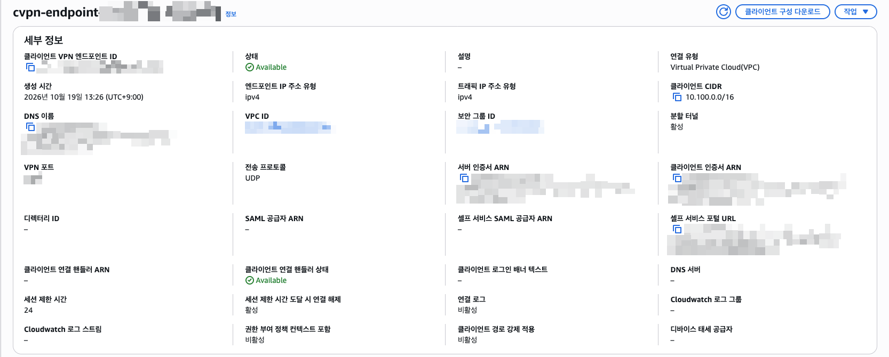
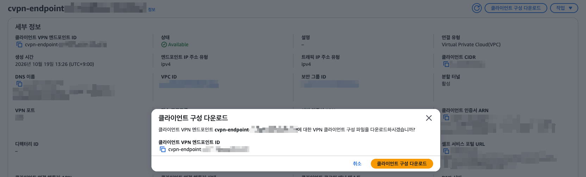
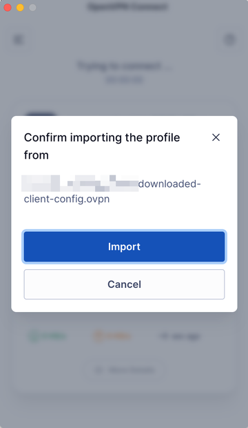
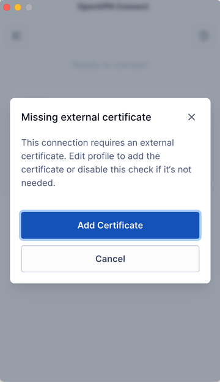
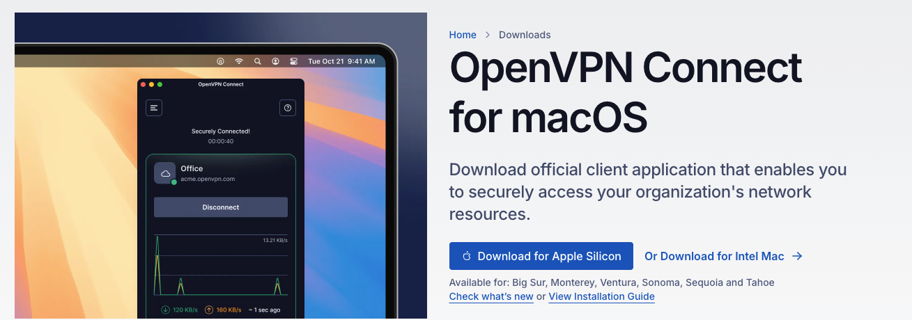
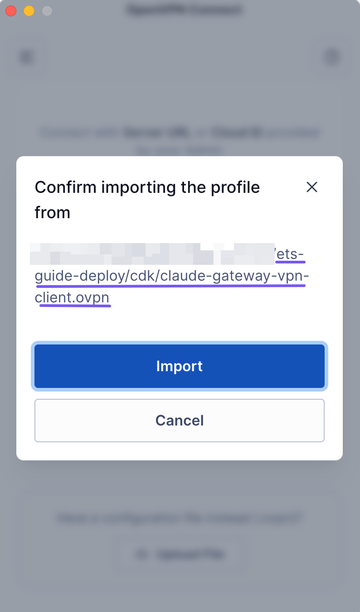
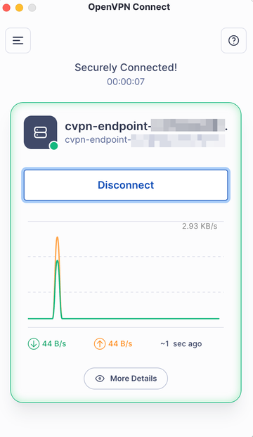

# 5. VPN 연결과 리다이렉트 URI

사인인 전에 VPN 을 연결하고, Entra 리다이렉트 URI 를 실제 주소로 바꿉니다. `cdk/` 에서 실행합니다.


## 5.1 VPN 연결

게이트웨이는 프라이빗 서브넷에 있어 VPN 으로만 닿습니다. 접속 프로필(`.ovpn`, 인증서·키 포함)은 4장 배포 때 Vpn 스택이 만들어 Secrets Manager 에 넣어 둡니다. 여기서는 그것을 로컬 파일로 내려받아 OpenVPN 클라이언트로 연결합니다.

> [!IMPORTANT]
> 관리자도 VPN 이 필요합니다. 관리 콘솔 사인인 중 브라우저가 게이트웨이의 `/device` 페이지로 이동하기 때문입니다. VPN 없이 사인인하면 오류 없이 무한 대기합니다.

### 콘솔에서 확인하는 방법
**VPC → Client VPN 엔드포인트** → 엔드포인트 선택 → **세부 정보**에서 상태 `Available`, 클라이언트 CIDR `10.100.0.0/16`, 분할 터널 `활성`을 확인합니다.



### VPN 프로필 내려받기 명령어
뒤의 `ls`·`grep` 은 확인용입니다. 인증서와 키는 화면에 출력하지 않습니다.

```bash
aws secretsmanager get-secret-value --secret-id "$(aws cloudformation describe-stacks --stack-name ClaudeGatewayVpnStack --query "Stacks[0].Outputs[?OutputKey=='VpnClientProfileSecretArn'].OutputValue" --output text)" --query SecretString --output text | jq -r .ovpnProfile > claude-gateway-vpn-client.ovpn && chmod 600 claude-gateway-vpn-client.ovpn && ls -l claude-gateway-vpn-client.ovpn && grep -E "^(client|dev|proto|remote|split-tunnel)" claude-gateway-vpn-client.ovpn && grep -c "BEGIN" claude-gateway-vpn-client.ovpn
```

### VPN 프로필 내려받기 결과 예시
```text
-rw-------@ 1 user  staff  4102 Oct 19 15:47 claude-gateway-vpn-client.ovpn
client
dev tun
proto udp
remote cvpn-endpoint-xxxxxxxxxxxxxxxxx.prod.clientvpn.us-east-1.amazonaws.com 443
remote-random-hostname
remote-cert-tls server
3
```

`remote` 의 엔드포인트 ID 가 4장 Vpn 스택 출력의 `ClientVpnEndpointId` 와 같고, 마지막 숫자(인증서·키 블록 수)가 `3` 이면 됩니다.

> [!WARNING]
> 콘솔의 **클라이언트 구성 다운로드** 버튼으로 받은 `downloaded-client-config.ovpn` 은 쓰지 않습니다. 이 VPN 은 상호 TLS 인증이라 클라이언트 인증서와 키가 필요한데, 콘솔 파일에는 그 두 가지가 없습니다. 위 명령으로 받은 파일에만 `<cert>`·`<key>` 가 들어 있습니다.

<details>
<summary>콘솔 파일을 불러왔을 때의 화면</summary>

콘솔에서 받은 파일을 불러와 연결하면 OpenVPN Connect 가 인증서를 추가하라고 묻습니다. **Cancel** 로 닫고, 그 프로필을 지운 뒤 위 명령으로 받은 파일을 다시 불러옵니다.



 
</details>

### OpenVPN Connect 로 연결
1. [OpenVPN Connect](https://openvpn.net/client/) 를 설치합니다. macOS 는 Apple Silicon·Intel 중 맞는 버전을 받습니다.

   

2. 받은 `claude-gateway-vpn-client.ovpn` 을 OpenVPN Connect 창으로 끌어다 놓거나 **Upload File** 로 불러옵니다. 경로가 위 명령을 실행한 `cdk/` 의 파일인지 확인하고 **Import** 를 누릅니다. `open .` 으로 `cdk/` 폴더를 Finder 에서 열 수 있습니다.
3. **Connect** 를 누릅니다. `Securely Connected!` 가 나오면 연결된 것입니다.

 

### 연결 확인 명령어
```bash
ifconfig | grep -A2 "^utun" | grep "inet 10.100"
```

### 연결 확인 결과 예시
```text
	inet 10.100.0.162 --> 10.100.0.161 netmask 0xffffffe0
```

`10.100.` 으로 시작하는 주소가 나오면 VPN 주소를 받은 것입니다. 숫자는 연결할 때마다 다를 수 있습니다.

> [!TIP]
> `.ovpn` 에는 클라이언트 인증서와 키가 들어 있으니 커밋하지 않습니다(`*.ovpn` 은 `.gitignore` 대상). 같은 파일을 [AWS VPN Client](https://docs.aws.amazon.com/vpn/latest/clientvpn-user/user-getting-started.html) 등 다른 OpenVPN 클라이언트로 불러와도 됩니다.

<details>
<summary>split-tunnel 인 이유</summary>

VPC 로 가는 트래픽만 터널을 타고, 브라우저의 Entra 로그인은 터널 밖으로 나갑니다. full-tunnel 로 바꾸면 Entra 로그인이 터널 안에서 막혀 사인인이 오류 없이 멈춥니다.
</details>

## 5.2 Entra 리다이렉트 URI 교체

로그인이 끝나면 Entra 가 사용자를 게이트웨이의 `/oauth/callback` 으로 돌려보냅니다. [1.2](01-entra-id.md#12-앱-등록)에서 임시값으로 둔 리다이렉트 URI 를 실제 게이트웨이 주소로 바꿉니다. 건너뛰면 로그인 끝에서 `AADSTS50011` 로 거부됩니다.

### 리다이렉트 URI 교체 명령어
```bash
GWEP=$(aws cloudformation describe-stacks --stack-name ClaudeGatewayStack --query "Stacks[0].Outputs[?OutputKey=='GatewayEndpoint'].OutputValue" --output text) && az ad app update --id "$APP" --web-redirect-uris "$GWEP/oauth/callback" && echo "$GWEP/oauth/callback"
```

### 리다이렉트 URI 교체 결과 예시
```text
https://cl-xxxxxxxxxxxxxxxxxxxxxxxxxxxxxxxx.ecs.us-east-1.on.aws/oauth/callback
```

`az ad app update` 는 성공하면 아무것도 출력하지 않습니다. 마지막 줄은 `echo` 로 찍은 새 URI 이며, 4.4 의 게이트웨이 주소 뒤에 `/oauth/callback` 이 붙은 형태면 됩니다.

### 리다이렉트 URI 확인 명령어
```bash
az ad app show --id "$APP" --query "web.redirectUris" -o tsv
```

### 리다이렉트 URI 확인 결과 예시
```text
https://cl-xxxxxxxxxxxxxxxxxxxxxxxxxxxxxxxx.ecs.us-east-1.on.aws/oauth/callback
```

임시값 `https://placeholder.invalid/oauth/callback` 이 사라지고 위 주소 하나만 나오면 됩니다.

## 5.3 헬스체크

VPN 을 거쳐 게이트웨이에 닿는지 확인합니다. VPN 이 연결된 상태에서 실행합니다.

### 헬스체크 명령어
```bash
curl -s -w "\n%{http_code} %{remote_ip}\n" "$GWEP/healthz"
```

### 헬스체크 결과 예시
```text
ok
200 10.0.x.x
```

`ok` 와 `200` 이 나오면 됩니다. 접속 IP 가 `10.0.` 으로 시작하는 VPC 내부 주소면 VPN 을 거쳐 닿은 것입니다.

> [!WARNING]
> VPN 없이 실행하면 게이트웨이 주소가 내부 IP 로만 풀려 응답 없이 시간 초과됩니다. 5.1 의 연결 상태를 먼저 확인합니다.

다음: [6. 배포 확인](06-verify.md)
