# 6. 배포 확인

다섯 항목이 모두 통과하면 인증, 비용 한도, 모델 관리, Bedrock 추론까지 확인된 것입니다. 모두 VPN 을 연결한 상태에서 진행합니다.

| 확인 | 방법 | 기대 결과 |
| --- | --- | --- |
| 게이트웨이 헬스 | `curl -s "$GWEP/healthz"` | `ok` |
| 관리 콘솔 사인인 | 브라우저로 `<AdminConsoleEndpoint>/signin` | Entra 로그인 후 `/spend/dashboard` 도착 |
| 비용 한도 | Limits 에서 테스트 한도 생성, Audit 확인 | actor 가 `oidc:<로그인한 관리자>` |
| 모델 접근 | Available models 화면 | Bedrock Anthropic 모델 목록, 기본 3종 `Offered` |
| 실제 추론 | Claude Code 로 게이트웨이 로그인 후 프롬프트 1회 | 응답 완료, Effective spend 에 사용자 표시 |

원본의 화면 설명은 [original/03-verify.md](original/03-verify.md) 에 있습니다.

## 6.1 게이트웨이 헬스

[5.3](05-vpn-and-redirect.md#53-헬스체크)에서 `ok` 와 `200` 을 확인했다면 통과입니다. 실패하면 CloudWatch 의 게이트웨이 로그 그룹에서 부팅 순서(설정 로드 → DB 마이그레이션 → `claude gateway listening`)를 확인합니다.

## 6.2 관리 콘솔 사인인

관리 콘솔은 게이트웨이를 거쳐 Entra 로 로그인하고, 토큰의 `groups` 에 Admin Group 이 있으면 관리자로 들어갑니다. 1·3장의 설정이 맞는지 여기서 확인됩니다. VPN 을 연결한 상태에서 진행합니다.

### 관리 콘솔 주소 확인 명령어
```bash
echo "$(aws cloudformation describe-stacks --stack-name ClaudeGatewayAdminConsoleStack --query "Stacks[0].Outputs[?OutputKey=='AdminConsoleEndpoint'].OutputValue" --output text)/signin"
```

### 관리 콘솔 주소 확인 결과 예시
```text
https://cl-yyyyyyyyyyyyyyyyyyyyyyyyyyyyyyyy.ecs.us-east-1.on.aws/signin
```

### 사인인 순서
1. 브라우저로 위 주소를 열고 **Sign in through the gateway** 를 누릅니다.

   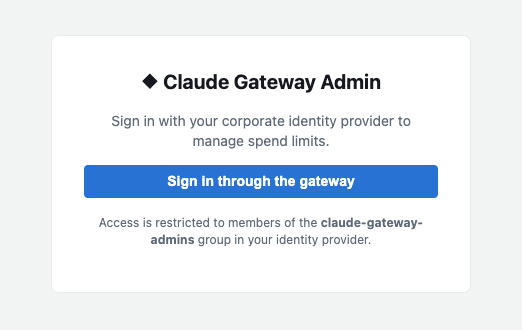

2. 확인 코드와 **Open verification page** 가 나옵니다. 버튼을 누르면 새 탭에 게이트웨이의 확인 페이지가 열리고, 이 화면은 `Waiting for confirmation...` 으로 기다립니다.

   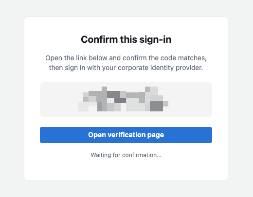

3. 새 탭의 **Approve sign-in?** 에서 코드가 앞 화면과 같은지 확인하고 **This matches my device — continue** 를 누릅니다. 이 페이지가 게이트웨이의 `/device` 이므로 VPN 이 필요합니다.

   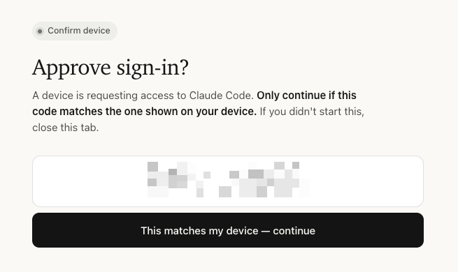

4. Entra 로그인으로 넘어갑니다. Admin Group 에 속한 계정으로 로그인합니다. 처음이면 **요청된 권한** 동의 화면이 나오며 **수락**을 누릅니다.

   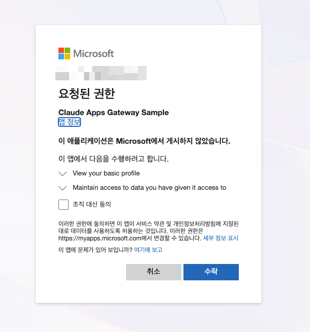

5. 첫 탭으로 돌아와 **Effective spend**(`/spend/dashboard`) 화면이 열리면 성공입니다. 왼쪽 메뉴에 Spend limits·Audit log·Available models 가 보이면 관리자로 인식된 것입니다.

   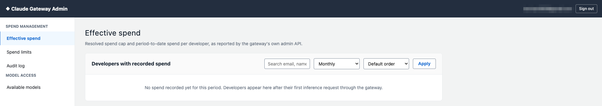

아직 추론 기록이 없어 `No spend recorded yet for this period.` 가 나오는 것이 정상입니다. 6.5 에서 추론을 한 번 하면 사용자가 나타납니다.

> [!TIP]
> 동의 화면의 **조직 대신 동의**는 테넌트 관리자만 체크할 수 있습니다. 체크하면 다른 사용자는 동의 화면 없이 바로 로그인합니다. 체크하지 않으면 사용자마다 처음 한 번 동의합니다.

> [!WARNING]
> `/not-authorized` 로 가면 Admin Group 판별이 실패한 것입니다. [10장](10-troubleshooting.md#사인인은-되는데-not-authorized)을 봅니다. 2단계에서 멈추면 VPN 연결을 확인합니다(5.1).

## 6.3 비용 한도와 감사 로그

관리 콘솔에서 바꾼 비용 한도가 게이트웨이에 바로 저장되고, 누가 바꿨는지 관리자 본인 ID 로 감사 로그에 남는지 확인합니다.

### Spend limits 화면
비용 한도(cap)를 만들고 지우는 화면입니다. 위쪽 **Create or replace a cap** 에서 범위와 금액·기간을 정해 **Save cap** 을 누르고, 아래 **Configured caps** 에서 현재 걸린 한도를 보고 **Delete** 로 지웁니다. 재배포 없이 다음 추론 요청부터 적용됩니다.

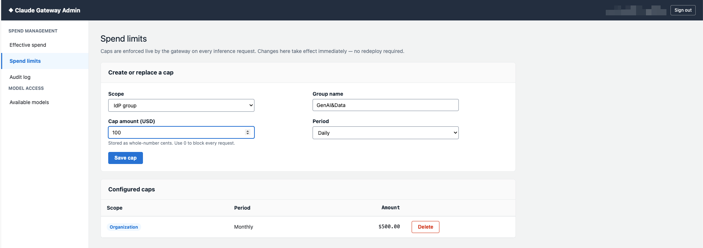

| 항목 | 의미 |
| --- | --- |
| Scope | `Organization`(조직 전체), `IdP group`(Entra 그룹), `Individual developer (OIDC sub)`(개인) |
| Cap amount (USD) | 한도 금액. 센트 단위 정수로 저장되며 `0` 이면 모든 요청을 막음 |
| Period | `Daily`·`Weekly`·`Monthly` 중 한도를 다시 채우는 주기 |

확인 순서:
1. 테스트 한도를 하나 만듭니다(예: Organization, Monthly, `500`).
2. **Configured caps** 에 방금 만든 한도가 보이는지 확인합니다.
3. 확인이 끝나면 **Delete** 로 지웁니다. 남겨 두면 실제 추론에도 적용됩니다.

### Audit log 화면
한도 변경 이력을 최신순으로 보여 주는 화면입니다. **Actor** 가 `oidc:<로그인한 관리자의 subject>` 이면, 콘솔이 고정된 관리자 키가 아니라 로그인한 관리자 본인의 권한으로 게이트웨이를 호출했다는 뜻입니다. **Change** 에는 무엇을 어떻게 바꿨는지(`Spend_limit.upsert cap`, 범위·금액·기간)가 남습니다.

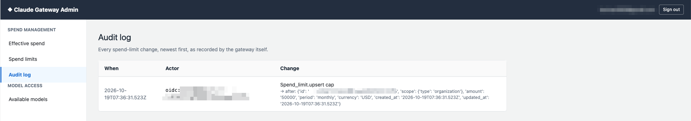

위 예시의 `amount: '50000'` 은 센트 단위라 $500 입니다. 한도를 지우면 삭제 기록이 한 줄 더 쌓입니다.

> [!IMPORTANT]
> 이 Audit log 는 **비용 한도 변경만** 기록합니다. 관리 콘솔 로그인, 추론 요청, 모델 접근(6.4) 변경은 남지 않습니다. 추론 사용량은 **Effective spend** 에서 보고, 모델 접근 변경은 CloudTrail 에 콘솔의 ECS task role 로 남습니다([7장](07-admin-console.md)).

<details>
<summary>게이트웨이 API 로 감사 로그 조회하기</summary>

관리자의 게이트웨이 토큰이 있으면 직접 조회할 수 있습니다. 관리 콘솔의 Audit log 화면이 부르는 것과 같은 API 입니다(`admin-console/app/gateway_client.py` 의 `get_audit`).

```bash
curl -s -H "Authorization: Bearer <관리자의 게이트웨이 토큰>" "$GWEP/v1/organizations/spend_limits/audit?limit=5"
```
</details>

## 6.4 모델 접근

개발자가 Claude Code 에서 고를 수 있는 모델을 정하는 화면입니다. 목록은 배포 Region 의 Bedrock 카탈로그에서 실시간으로 읽어 옵니다.

### Available models 화면
**Model catalog** 에 Bedrock 의 Anthropic 모델이 나오고, 체크한 모델이 **Currently** 열에 `Offered`(개발자에게 제공 중)로 표시됩니다. 체크를 바꿔 적용하면 게이트웨이 설정을 바꿔 재배포하므로, 몇 분 뒤 모든 개발자에게 한꺼번에 반영됩니다.

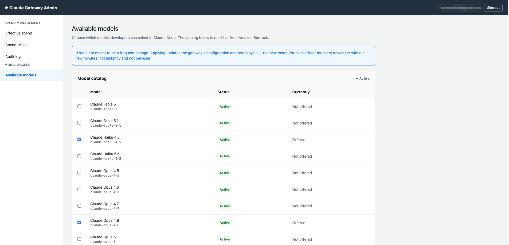

배포 직후 기본으로 제공되는 모델은 `claude-opus-4-8`, `claude-sonnet-4-6`, `claude-haiku-4-5` 세 개입니다(`cdk/lib/gateway-stack.ts` 의 `AVAILABLE_MODELS_RAW`). 이 세 개가 `Offered` 이고 나머지는 `Not offered` 이면 됩니다.

> [!TIP]
> 자주 바꿀 설정이 아닙니다. 바꾸면 게이트웨이가 재배포되는 동안 몇 분간 이전 목록이 보일 수 있습니다. Claude Code 는 게이트웨이 설정을 시작할 때와 1시간마다 받아 오므로, 목록을 바꾼 뒤에는 Claude Code 를 다시 시작해야 새 목록을 씁니다. 목록에 넣는 모델은 [2.4](02-aws-preparation.md#24-bedrock-추론-프로파일-확인)대로 계정에서 구독돼 있어야 합니다.

### 모델 목록을 바꾼 화면
모델을 체크하고 적용하면 위쪽에 `Applied N model(s). This will take effect for all developers within a few minutes.` 가 나오고, **Model catalog** 오른쪽 상태가 `Applying...` 으로 바뀝니다. 게이트웨이 재배포가 끝나면 `Active` 로 돌아옵니다.

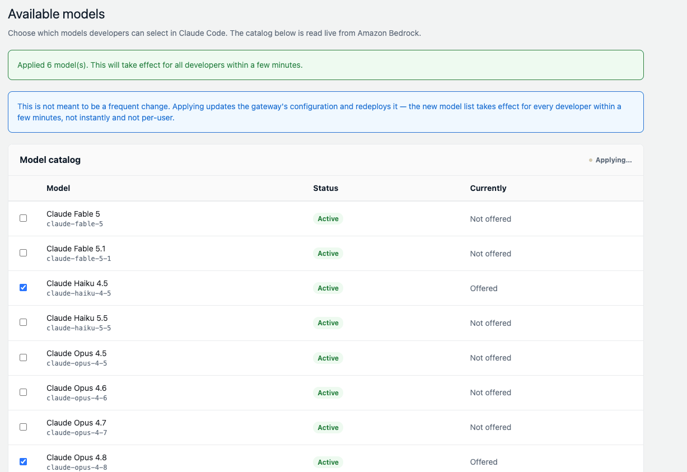

## 6.5 실제 추론

개발자 PC 의 Claude Code 가 게이트웨이로 로그인하고, 게이트웨이를 거쳐 Bedrock 으로 추론하는지 확인합니다. Claude Code 는 게이트웨이 주소를 OS 의 **managed settings**(관리자 정책 파일)에서만 읽으므로 그 파일을 씁니다.

> [!WARNING]
> managed settings 는 그 PC 의 **모든** Claude Code 에 적용됩니다. 쓰고 나면 이 PC 의 Claude Code 는 게이트웨이로만 로그인합니다. 평가가 끝나면 아래 **되돌리기**로 파일을 지웁니다.

> [!IMPORTANT]
> 게이트웨이 로그인 키(`forceLoginMethod: "gateway"`, `forceLoginGatewayUrl`)는 관리자 소스(시스템 경로의 파일, MDM, Windows HKLM)에서만 읽습니다. 개인 `~/.claude/settings.json` 이나 Windows `HKCU` 레지스트리에 넣으면 적용되지 않습니다. 근거: [Deploy managed settings](https://code.claude.com/docs/en/managed-settings)

### managed settings 쓰기 명령어 (macOS)
`$GWEP` 는 [4.4](04-deploy.md#44-출력값-기록)의 게이트웨이 주소입니다. `sudo` 비밀번호를 묻습니다.

```bash
sudo mkdir -p "/Library/Application Support/ClaudeCode" && printf '{\n  "forceLoginMethod": "gateway",\n  "forceLoginGatewayUrl": "%s"\n}\n' "$GWEP" | sudo tee "/Library/Application Support/ClaudeCode/managed-settings.json"
```

### managed settings 쓰기 결과 예시 (macOS)
```json
{
  "forceLoginMethod": "gateway",
  "forceLoginGatewayUrl": "https://cl-xxxxxxxxxxxxxxxxxxxxxxxxxxxxxxxx.ecs.us-east-1.on.aws"
}
```

### managed settings 파일 (Windows)
Windows 는 아래 경로에 같은 내용의 파일을 만듭니다. `C:\Program Files` 아래라 관리자 권한이 필요합니다. `<GatewayEndpoint>` 는 4.4 의 게이트웨이 주소로 바꿉니다.

| 항목 | 값 |
| --- | --- |
| 경로 | `C:\Program Files\ClaudeCode\managed-settings.json` |
| 읽지 않는 예전 경로 | `C:\ProgramData\ClaudeCode\managed-settings.json` |

```json
{
  "forceLoginMethod": "gateway",
  "forceLoginGatewayUrl": "https://<GatewayEndpoint>"
}
```

> [!NOTE]
> Windows 절차는 이 가이드에서 검증하지 않았습니다. 경로와 읽는 순서는 [Deploy managed settings](https://code.claude.com/docs/en/managed-settings) 기준입니다.

### 추론 확인 순서
0. 6.4 에서 `Offered` 인 모델이 계정에서 구독돼 있는지 [2.4](02-aws-preparation.md#24-bedrock-추론-프로파일-확인)의 모델 구독 확인 명령으로 봅니다. 구독되지 않은 모델로 요청하면 403 으로 실패합니다.
1. VPN 을 연결한 채 **새** 터미널에서 `claude` 를 실행합니다. 이미 떠 있는 Claude Code 는 다시 시작해야 새 설정과 모델 목록을 읽습니다.
2. `/status` 의 `Setting sources` 에 `Enterprise managed settings (file)` 이 있는지 봅니다.
3. "Trust gateway" 프롬프트의 호스트명이 방금 배포한 게이트웨이(`cl-….ecs.us-east-1.on.aws`)인지 확인합니다.
4. device 인증을 승인합니다. Claude Code 가 연 브라우저 탭의 **Approve sign-in?** 에서 코드가 터미널에 보이는 코드와 같은지 확인하고 **This matches my device — continue** 를 누릅니다. 이어서 Entra 로그인(6.2 와 같은 흐름)을 마치면 `You're signed in.` 이 나오고 탭을 닫아도 됩니다. 그다음 프롬프트를 하나 실행합니다.

   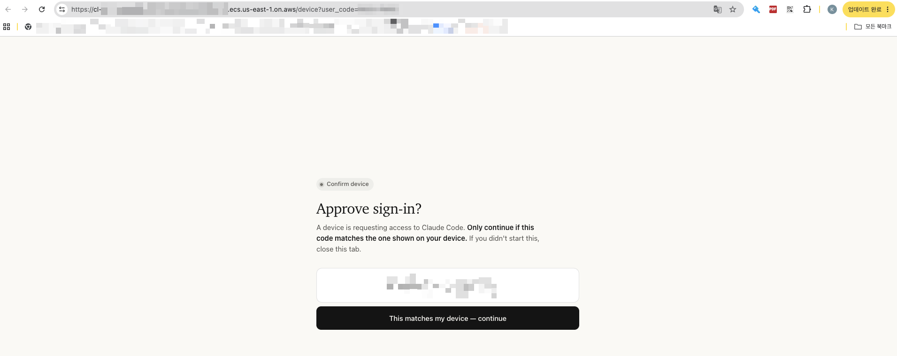

   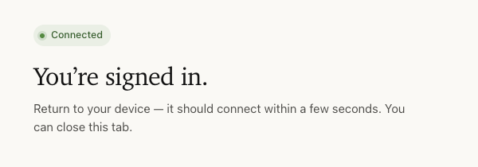

5. 관리 콘솔 **Effective spend** 에 로그인한 사용자와 사용액이 나타나는지 봅니다. 추론은 Audit log 에 남지 않습니다.

<details>
<summary>되돌리기</summary>

파일을 지우고 Claude Code 를 다시 시작하면 원래 로그인 방식으로 돌아갑니다.

macOS:

```bash
sudo rm "/Library/Application Support/ClaudeCode/managed-settings.json"
```

Windows 는 `C:\Program Files\ClaudeCode\managed-settings.json` 파일을 지웁니다.
</details>

다음: [7. 관리 콘솔 사용법](07-admin-console.md)
